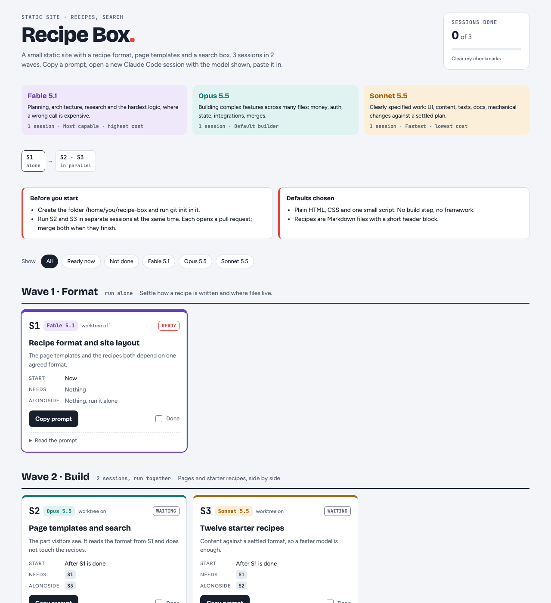

# Session Board Lite

**One big job in, a board of paste-ready Claude Code session prompts out, with the parallel waves worked out for you.**

Session Board Lite is a free Claude Code skill. It splits one big job into separate sessions you can
run in parallel, writes a prompt for each, and builds a local HTML board with one card per session.
Each card shows the prompt with a Copy button, the model to pick, when to start it, what it needs
first and which sessions can run alongside it. Claude checks the plan first and refuses one where
two sessions running at the same time own the same files.



*A board built from an invented job: a recipe site split into three sessions in two waves.*

It is not an agent runner. It does not start the sessions, watch them or merge their work: you
paste each prompt into a new Claude Code session yourself. For work that fits in one session it
says so and does not build a board.

## Install

Needs Claude Code 2.1.116 or newer and a browser. The board is built with `awk`, which ships with
macOS and Linux (on Windows, Git Bash or WSL).

```bash
claude plugin marketplace add adityavora16/claude-plugins
claude plugin install session-board-lite@adityavora
```

Open a new Claude Code session in a project folder and type:

```
/session-board-lite:session-board-lite Plan a small recipe website with a recipe format, page templates and a search box.
```

Claude reads the folder, splits the job, writes `docs/sessions/plan.json`, builds the board and
gives you the path to an HTML file. Other ways in (copy the skill folder, or load it for one
session) are in [`INSTALL.md`](INSTALL.md).

## How it works

1. You describe the job. Claude reads your project folder and asks only the questions that would
   change the split.
2. It splits the job into sessions, one outcome each, and groups them into waves. Everything in a
   wave can run at the same time. A contracts session goes first when several sessions build
   against a shared schema or API, and an integration session goes last.
3. It writes `plan.json` and checks it: it rejects a plan where two sessions in one wave own the
   same path, or where one owns a folder that contains the other's, and warns about prompts too thin
   to stand alone.
4. It writes the board as a local HTML file. To change the board, edit `plan.json` and build again:

   ```bash
   awk '/^```html$/{on=1;next} /^```$/{on=0} on' skills/session-board-lite/references/board-template.md | awk -v plan=docs/sessions/plan.json '$0=="__DATA__"{while((getline l < plan)>0){gsub(/<\//,"<\\/",l); print l}; next} {print}' > session-board.html
   ```

A plan with more than six sessions or more than three waves still builds; the board then says the
job is big enough for the full Session Board.

## What is in the repo

| Path | What it is |
|---|---|
| `skills/session-board-lite/SKILL.md` | the skill: how to split a job, the plan format, the checks, the build step |
| `skills/session-board-lite/references/board-template.md` | the board page, kept in Markdown |
| screenshot folder | the screenshot above |
| `.claude-plugin/plugin.json` | the plugin manifest |
| `INSTALL.md`, `CREDITS.md`, `CHANGELOG.md`, `LICENSE` | install routes, credits, versions, licence |

## Lite and the full Session Board

| | Lite | Full Session Board |
|---|---|---|
| Split a job into sessions and waves | yes | yes |
| One paste-ready prompt per session, with a Copy button | yes | yes |
| Rejects two sessions in one wave that own the same files | yes | yes |
| Local HTML board | yes | yes |
| Paste a session's report back and the board updates | no | yes |
| Done, running and blocked states kept current for you | no | yes |
| Re-plan: split, skip or add a session mid-job | no | yes |
| Publish the board as a shareable page | no | yes |
| Which model for which kind of session, with the reasons | one line | a full table |
| A worked example plan with screenshots | no | yes |

## More for editors

Paid Claude Code skills from the same author:

- [Session Board](https://adityavora.gumroad.com/l/session-board?utm_source=github&utm_medium=readme&utm_campaign=useu-q4): the full version, which keeps the board current as sessions report back.
- [Editor's Brain](https://adityavora.gumroad.com/l/editors-brain?utm_source=github&utm_medium=readme&utm_campaign=useu-q4): the planning half of editing, done to a method, from one script.
- [AE Script Builder](https://adityavora.gumroad.com/l/ae-script-builder?utm_source=github&utm_medium=readme&utm_campaign=useu-q4): scripted After Effects comps, checked before you press Run.
- [Chart Shorts Kit](https://adityavora.gumroad.com/l/chart-shorts-kit?utm_source=github&utm_medium=readme&utm_campaign=useu-q4): numbers in, a finished 38-second chart Short out. No After Effects.

Also free: [Terse](https://github.com/adityavora16/terse) makes Claude Code answer in the first
sentence and stop.

## Licence

MIT, see [`LICENSE`](LICENSE). The fonts a board loads from Google Fonts are under the SIL Open Font
License 1.1; details in [`CREDITS.md`](CREDITS.md).

Provided as is. You are responsible for what the sessions you launch do to your projects.

## Privacy

Session Board Lite collects and sends no data. Its build step is one `awk` command that runs on your
machine, makes no network calls, and writes the board as a local HTML file in your project. When
you open that file in a browser, the page loads its fonts from Google Fonts (fonts.googleapis.com
and fonts.gstatic.com), so your browser makes those requests; no plan, prompt or project content
is sent with them. Nothing is retained anywhere except the files written to your own disk.
